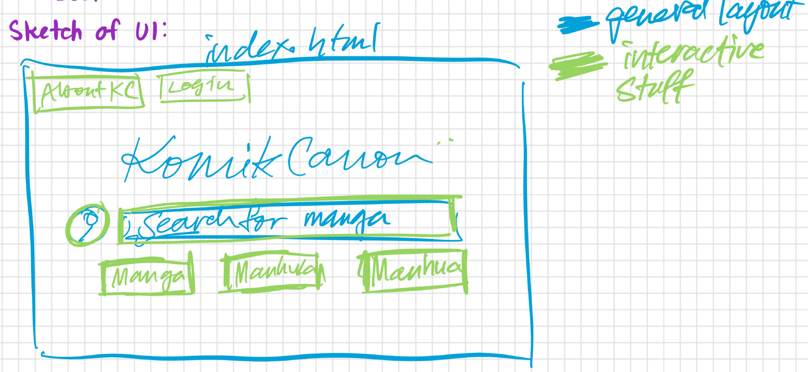
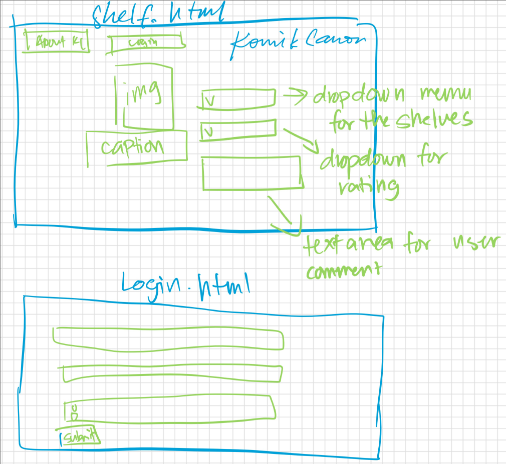

# COSC 219 M1-PROPOSAL

## **By Jen Juanich & Reyan Ragual**

---

## AI Use Declaration

_Artificial Intelligence_ was utilized in this planning phase of the project for idea generation, comparison, and refinement.
During the planning, the LLM used (Claude) provided more legitimate sources for further research. This section will be
updated throughout the project when necessary.

## App Functionality

This project is a website for browsing and searching manga, manhwa, and manhua using live data from
AniList API, with filters, country of origin, genre, and status. Users can save series of shelves that persist between visits using `localStorage`.

## Intended Users

This website is intended for manga/manhwa readers who want to keep track of the books they like. They can also use this
webiste to organize the books they like in different categories and be able to leave a rating and comment about
the book.

## API Used

**[AniList Documentation](https://docs.anilist.co)**

Fetch block:

```js
fetch("https://graphql.anilist.co", {
  method: "POST",
  headers: { "Content-Type": "application/json", Accept: "application/json" },
  body: JSON.stringify({
    query: query,
    variables: { search: "solo leveling" },
  }),
})
  .then((response) => {
    console.log("ok:", response.ok, "status:", response.status);
    return response.json();
  })
  .then((data) => console.log(JSON.stringify(data, null, 2)))
  .catch((error) => console.error("FAILED:", error));
```

First few lines of the response:

```
{
  "data": {
    "Page": {
      "media": [
        {
          "id": 105398,
          "title": {
            "romaji": "Na Honjaman Level Up",
            "english": "Solo Leveling"
          },
          "averageScore": 84,
          "chapters": 201,
          "status": "FINISHED"
        }
```

## Hardest out of the 6 Hard Requirements

**Working on both phone and laptop (Requirement 4)** is the one we expect to be the most challenging in this project.
Our project packs a lot of controls into one screen: search bar, login, genre and status filter, detail view etc.
These controls could easily fit in a laptop, but the same controls could push the results off the screen or become too
small to tap.

## Rough Sketches of the UI





## Workload Distribution

We are splitting the work by feature, so each of us builds our part end to end
(HTML, CSS, and JavaScript) and can explain it at the demo.

**Jen: Browse and Discover**

- Search Box, filters (origin, genre, status), and sorting
- Results grid with "Load More" Pagination
- Loading, empty, loaded and error states for the result
- Responsive layout of the browse page

**Reyan: Shelves and Persistence**

- Shelves("Plan to Read", "Reading","Completed") and personal ratings
- Saving to localStorage, with handling for missing or corrupt data
- Export and Import of a shelf as copy-and-paste text
- Responsive layout of the page

**Shared work (written together)**

- The fetch wrapper that talks to the AniList API
- The series detail view
- Keyboard and accessibilty testing
- Deployment to GitHub Pages and final README

To make sure both of us understand all of the code, we will review each
other's pull requests and each commit regularly to the shared repository
